# Hotel IT Support Lab

A Windows domain for a fictional hotel, built from scratch in VirtualBox to get hands-on experience with the tools and tasks of an IT support role: Active Directory, file permissions, Group Policy, network troubleshooting and support tickets.

> **Built:** October 2026 · **Platform:** VirtualBox on a Windows laptop (8 GB RAM) · **Status:** Core lab and four support tickets complete

---

## Why I built this

I learned the theory through Cisco Networking Academy courses. This lab is where I tried it hands-on, with the same tools used in IT support every day, to understand how the pieces fit together and how to troubleshoot when they don't.

Everything here was done by me, step by step, and every result is backed by a screenshot. Things went wrong along the way, and those are documented too: see [troubleshooting.md](troubleshooting.md).

## What's in this repo

| Path | Contents |
|---|---|
| `README.md` | Lab overview, build steps and verification (this page) |
| [`tickets/`](tickets/) | Four support tickets, each documented from request to verification |
| [`troubleshooting.md`](troubleshooting.md) | 17 problems I hit during the build, with cause and fix |
| [`screenshots/`](screenshots/) | All evidence referenced in the documentation |

## Skills demonstrated

- Windows Server 2025 installation and configuration
- Active Directory Domain Services: domain controller, OUs, users, security groups
- DNS and domain join of a Windows 11 client
- NTFS and share permissions based on least privilege
- Group Policy: password policy, account lockout, screen lock, removable storage block
- Troubleshooting with `ipconfig`, `nslookup`, `whoami`, `gpupdate`, `gpresult` and PowerShell (`Get-ADUser`)
- Support ticket handling: account unlock, password reset with identity verification, onboarding and offboarding
- Documentation of every step, including what went wrong

---

## Lab environment

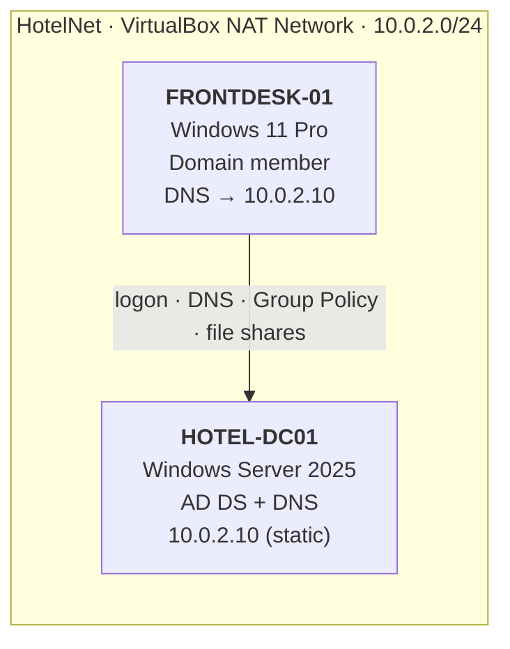

| Machine | Role | OS | Network |
|---|---|---|---|
| HOTEL-DC01 | Domain controller and DNS for `hotel.local` | Windows Server 2025 Standard Evaluation (Desktop Experience) | Static IP 10.0.2.10 / 24, gateway 10.0.2.1, DNS 127.0.0.1 |
| FRONTDESK-01 | Reception workstation | Windows 11 Pro | DHCP on HotelNet, DNS set to 10.0.2.10 |

### Active Directory structure

```
hotel.local
└── Hotel
    ├── Reception        anna.andersson, erik.nilsson*   GRP-Reception
    ├── Housekeeping     sara.lind, jonas.ek              GRP-Housekeeping
    ├── Management       maria.berg                       GRP-Management
    ├── Hotel Computers  FRONTDESK-01                     (Front Desk Security GPO)
    └── Disabled Users   erik.nilsson*                    (moved here in ticket 004)
```

### File shares on HOTEL-DC01

| Share | Allowed (NTFS Modify) | Denied |
|---|---|---|
| `\\HOTEL-DC01\GuestBookings` | GRP-Reception, GRP-Management | Housekeeping |
| `\\HOTEL-DC01\Payroll` | GRP-Management | Reception, Housekeeping |

All users, names and data are fictional.

---

## Part 1: Network and virtual machines

**Goal:** two machines on a private network that can see each other without touching my home network.

1. Switched VirtualBox from Basic to Expert mode to reach the network settings.
2. Created the NAT Network **HotelNet** (10.0.2.0/24, DHCP on) and attached both VMs to it.
3. Installed **Windows 11 Pro** on FRONTDESK-01. Pro is required, because Home cannot join a domain.
4. Installed **Windows Server 2025** on HOTEL-DC01, set the time zone, renamed it and gave it a static IP.

| | |
|---|---|
| 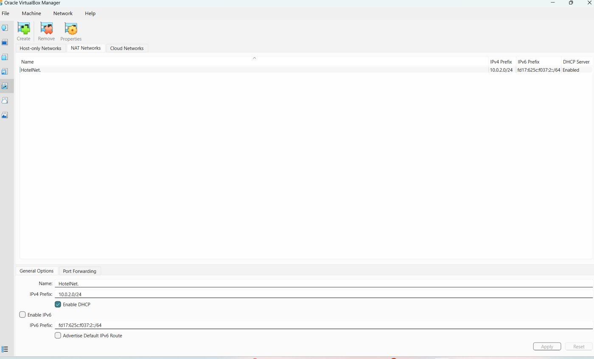 | 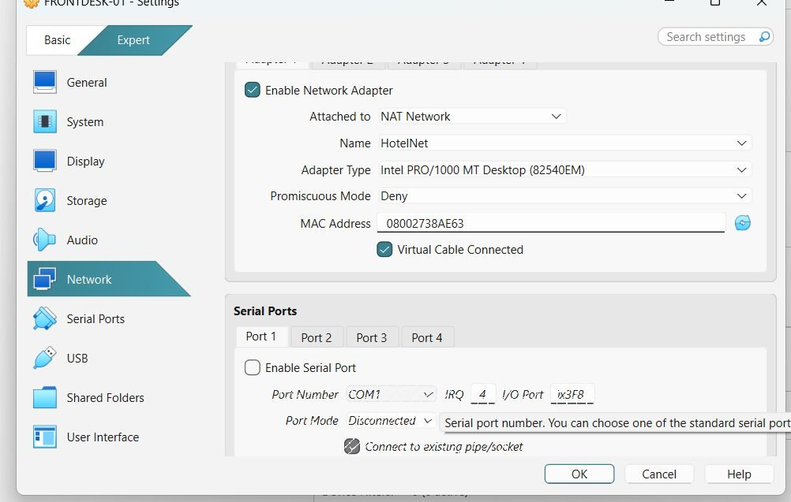 |
| HotelNet: 10.0.2.0/24 with DHCP | Adapter 1 attached to NAT Network → HotelNet |

> **In plain terms:** I built a small company network on my own computer: one server that controls everything and one normal work PC.

## Part 2: Active Directory

**Goal:** every employee gets their own account, and access is controlled per department instead of per computer.

1. Added the **Active Directory Domain Services** role.
2. Promoted the server to a domain controller for a new forest, `hotel.local`, with DNS.
3. Created an OU per department, users in each OU and a global security group per department.

| | |
|---|---|
| 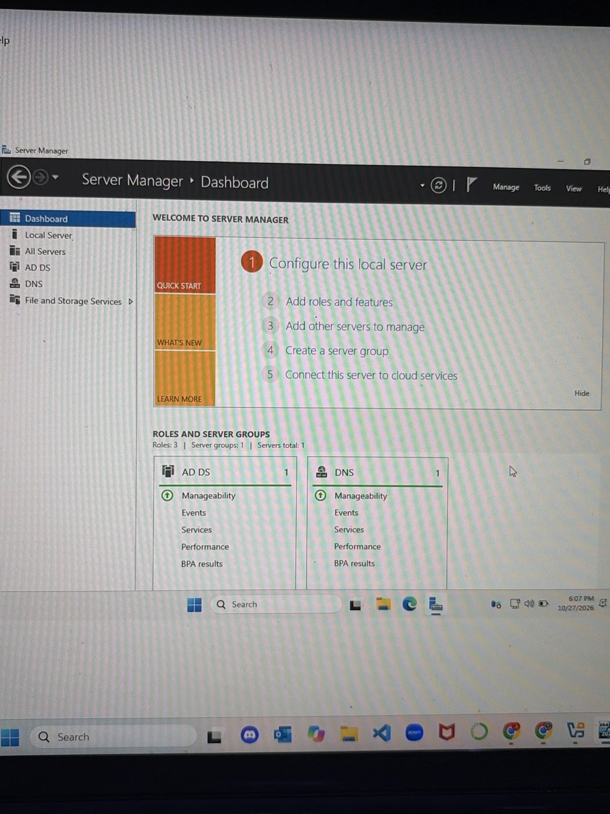 | 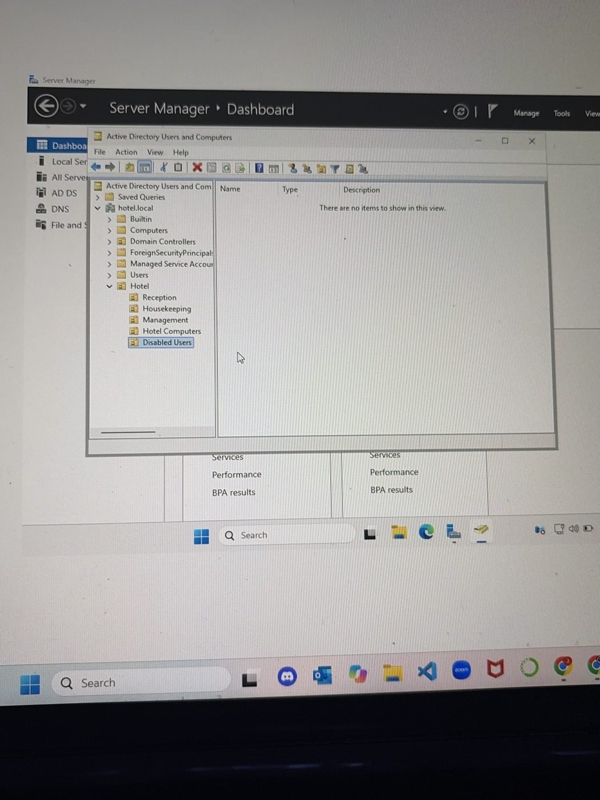 |
| AD DS and DNS running on HOTEL-DC01 | OU structure under Hotel |

> **In plain terms:** each employee gets an account and ends up in the right department, like giving the right key card to the right person. When someone joins, changes role or leaves, you change it in one place.

## Part 3: Permissions and confidential data

**Goal:** Housekeeping must not see guest bookings, and only Management may see payroll. It must be proven from a user's PC, not just look right in the settings.

1. Created `C:\Shares\GuestBookings` and `C:\Shares\Payroll` and shared them.
2. NTFS: disabled inheritance, removed `Users`, kept Administrators and SYSTEM, and gave **Modify** only to the groups that need the data.
3. Tested by logging in as different users on FRONTDESK-01.

| Test | User | Share | Expected | Result |
|---|---|---|---|---|
| 1 | sara.lind (Housekeeping) | GuestBookings | Denied | Denied ✅ |
| 2 | anna.andersson (Reception) | GuestBookings | Read and write | Created `booking-test.txt` ✅ |
| 3 | anna.andersson (Reception) | Payroll | Denied | Denied ✅ |

| | | |
|---|---|---|
| 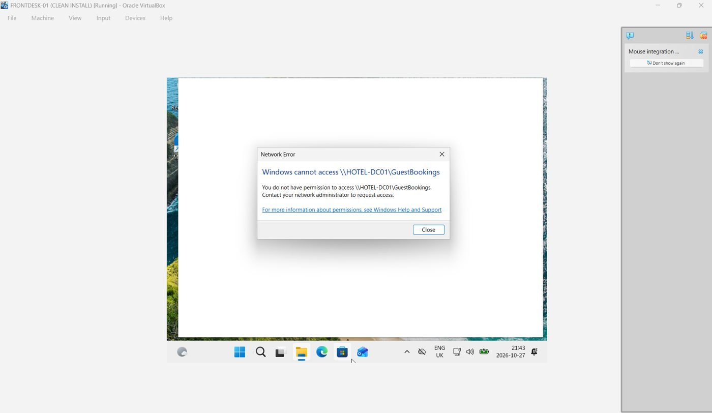 | 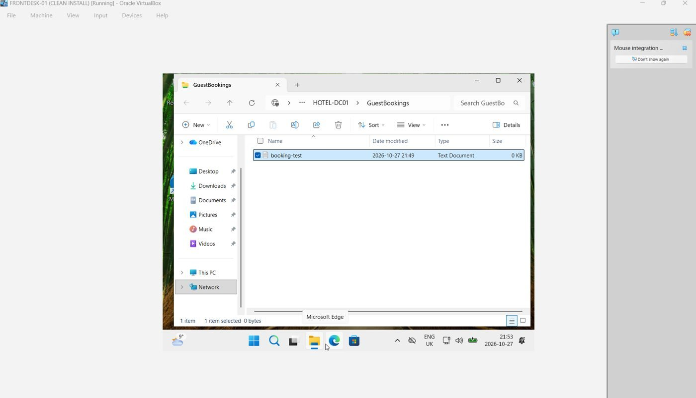 | 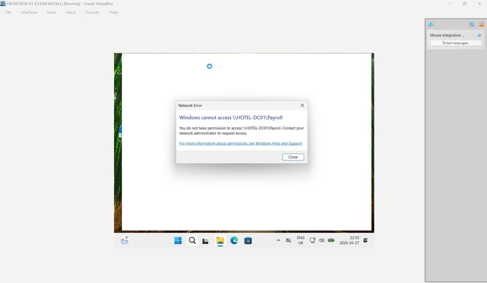 |
| Test 1 | Test 2 | Test 3 |

> **In plain terms:** sensitive folders are locked so only the right department gets in. Testing both "should get in" and "should be denied" proves the lock actually works.

## Part 4: Group Policy

**Goal:** the same security rules on every reception PC, without configuring each machine by hand.

| GPO | Linked to | Setting |
|---|---|---|
| Default Domain Policy | `hotel.local` | Minimum password length 12 |
| Default Domain Policy | `hotel.local` | Account lockout after 5 failed attempts |
| Front Desk Security | OU Hotel Computers | Machine inactivity limit 180 seconds (screen lock) |
| Front Desk Security | OU Hotel Computers | All Removable Storage classes: Deny all access |

**Verified** on FRONTDESK-01 with `gpupdate /force` and `gpresult /r /scope computer`: the computer sits in `OU=Hotel Computers`, policy came from `HOTEL-DC01.hotel.local`, and both GPOs are applied.

| | |
|---|---|
| 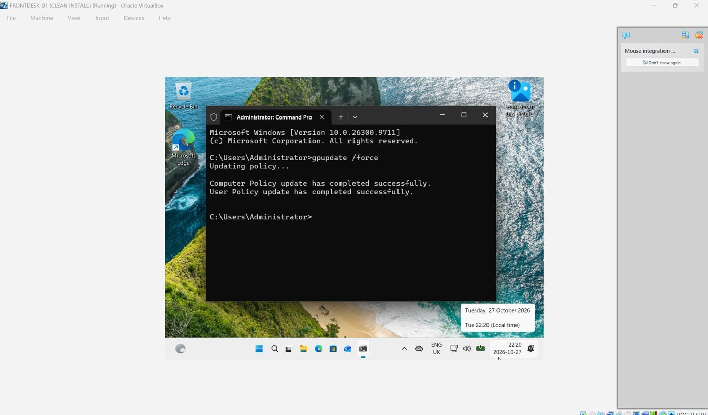 | 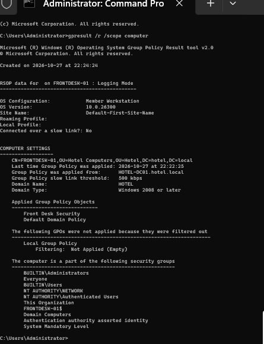 |
| `gpupdate /force` | `gpresult`: both GPOs applied |

> **In plain terms:** rules are set once on the server and reach every PC automatically. Nobody has to visit each computer, and no computer gets forgotten.

## Part 5: DNS troubleshooting and domain join

**Goal:** join FRONTDESK-01 to `hotel.local`. The first attempt to reach the server failed.

1. `nslookup hotel.local` timed out, even though the client was asking the right server (10.0.2.10).
2. Checked in order: is the server running, does it have the right address (`ipconfig` → 10.0.2.10), is the client on the right network?
3. The DNS service hadn't finished starting after a reboot. The next `nslookup` resolved `hotel.local` → 10.0.2.10.
4. The domain join then failed with *"user name or password is incorrect"*. That meant the client **had** found the domain. I verified the password on the server and retried with `Administrator@hotel.local`, which succeeded.
5. Logged in as `hotel\anna.andersson` and moved the computer object into **Hotel Computers**.

| | |
|---|---|
| 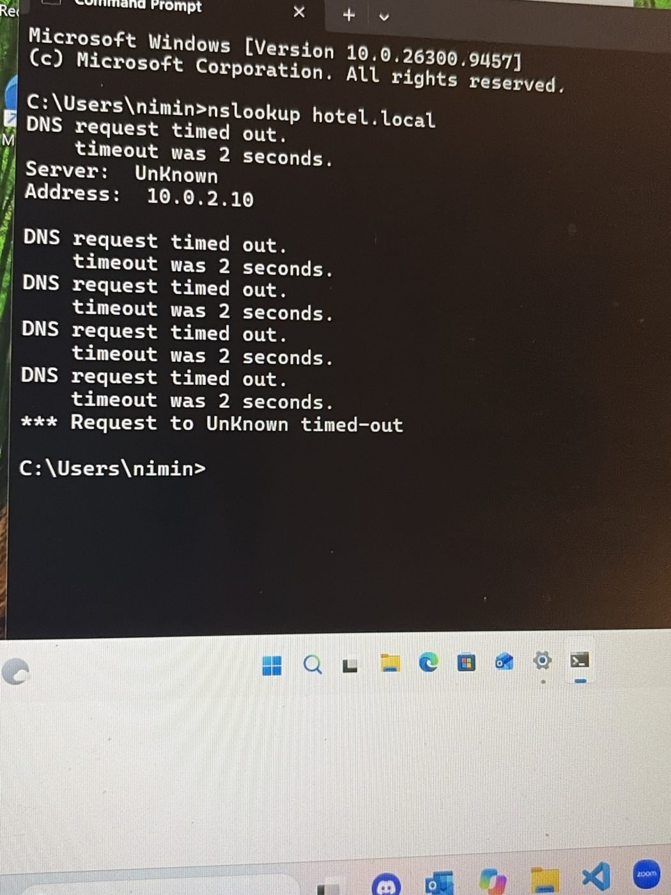 | 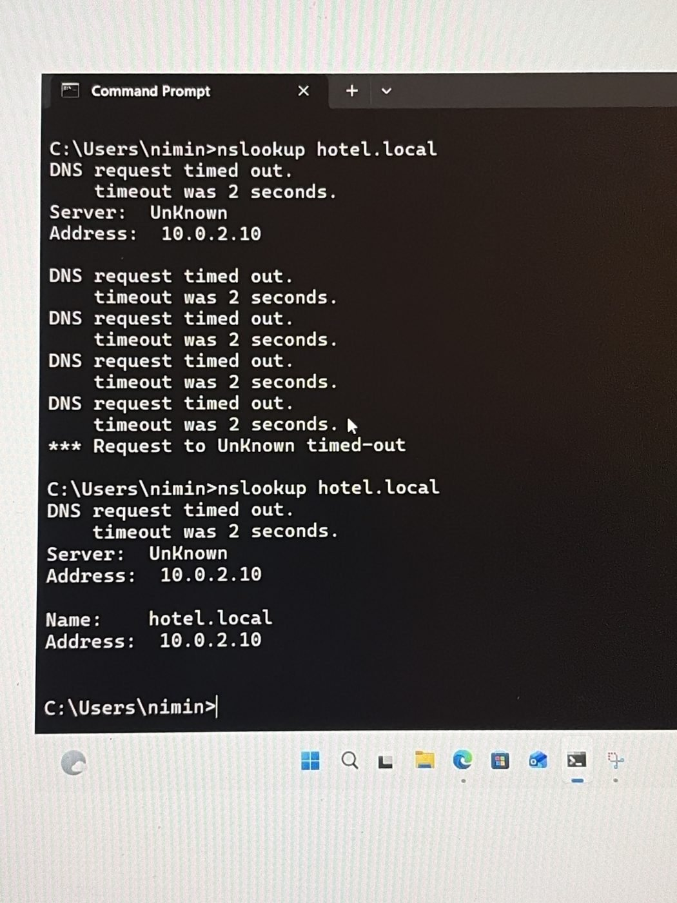 |
| First attempt: timeout | After troubleshooting: 10.0.2.10 |
| 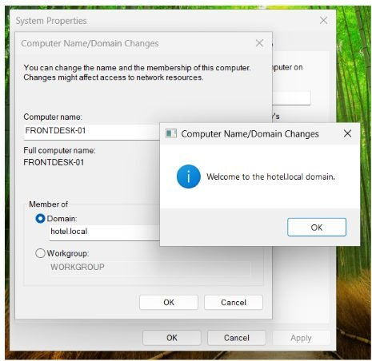 | 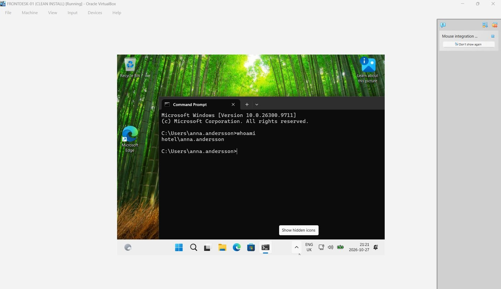 |
| Joined to hotel.local | `whoami` → `hotel\anna.andersson` |

*Note:* `nslookup` still shows `Server: UnKnown` because there is no reverse lookup zone for 10.0.2.x. Name resolution for `hotel.local` works fine.

> **In plain terms:** many "I can't log in" problems are really network problems. Checking one thing at a time finds the cause faster than guessing.

---

## Support tickets

Four of the most common identity tickets in IT support, each documented with the same structure: requester, problem, priority, actions, result, time.

| # | Ticket | Requester | Priority | Result |
|---|---|---|---|---|
| 001 | [Account locked out](tickets/001-account-locked-out.md) | Erik Nilsson, Reception | High | Unlocked, logged in again |
| 002 | [Forgotten password](tickets/002-forgotten-password.md) | Anna Andersson, Reception | High | User set her own new password |
| 003 | [New employee (onboarding)](tickets/003-new-employee-onboarding.md) | Housekeeping manager | Normal | Account with correct group |
| 004 | [Employee leaving (offboarding)](tickets/004-employee-offboarding.md) | Reception manager | High | Account disabled, access removed |

---

## Lessons learned

- Check one thing at a time and start with the basics, often DNS.
- Read the error message. "Wrong password" during a domain join meant the network was fine.
- Test both what should work and what should be denied.
- A locked account and a disabled account are different things, and both can be verified.
- Document what went wrong as carefully as what worked.

## Known gaps

- The screen lock and USB block are confirmed as applied (`gpresult`) but not yet tested hands-on on the client.
- Identity verification in ticket 002 is a described procedure. In the lab there was no real caller.
- This is a small lab with fictional users. It doesn't replace experience in a real environment, but the principles are the same.

## Next steps

- [ ] PowerShell script to create users in bulk from a CSV file
- [ ] Monitor failed logons and lockouts (event IDs 4625 and 4740) in Event Viewer
- [ ] Protect the client with BitLocker and Windows LAPS
- [ ] Rebuild the same setup in the cloud with Microsoft Entra ID and Intune
- [ ] Network segmentation with VLANs and ACLs in Cisco Packet Tracer
