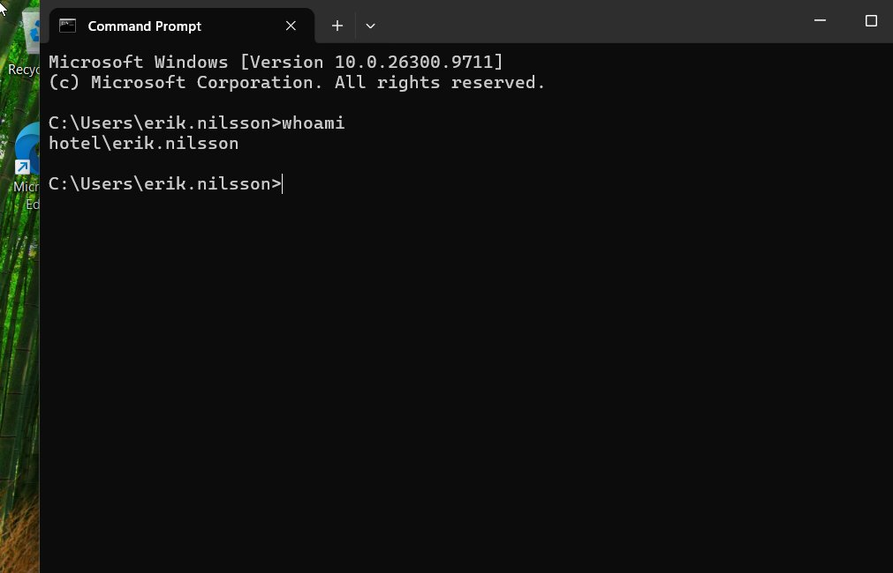
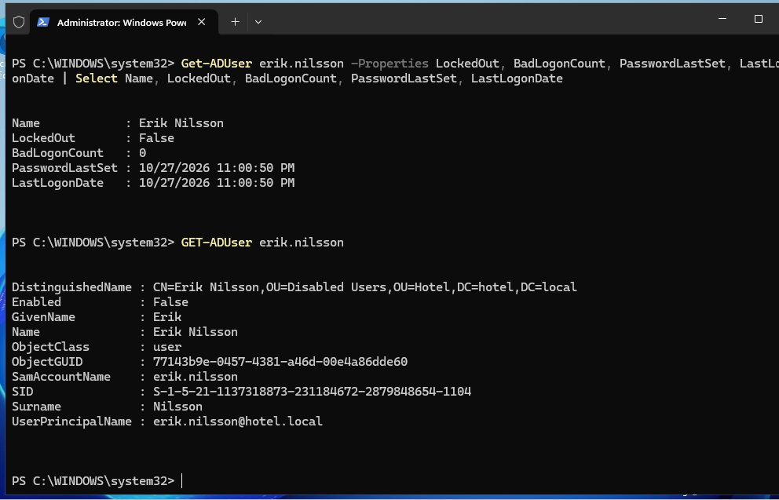

# Ticket 001: Account locked out

| Field | Value |
|---|---|
| **Requester** | Erik Nilsson, Reception |
| **Category** | Account / Access |
| **Problem** | Cannot log in, account is locked |
| **Priority** | High (user cannot work) |
| **Time spent** | ~5 minutes |
| **Status** | Resolved |

## Background

The domain's account lockout policy locks an account after 5 failed logon attempts. To reproduce the problem, I entered a wrong password 5 times as `erik.nilsson` on FRONTDESK-01, and the account was locked.

## Actions

1. On HOTEL-DC01, opened **Active Directory Users and Computers → Hotel → Reception**.
2. Opened Erik's account, went to the **Account** tab and ticked **Unlock account**.
3. Erik logged in on FRONTDESK-01 with his correct password.

## Verification

On the client:
```
C:\> whoami
hotel\erik.nilsson
```

On the domain controller:
```powershell
Get-ADUser erik.nilsson -Properties LockedOut, BadLogonCount, PasswordLastSet, LastLogonDate |
    Select Name, LockedOut, BadLogonCount, PasswordLastSet, LastLogonDate
```
Result: `LockedOut : False`, `BadLogonCount : 0`.

| | |
|---|---|
|  |  |
| `whoami` after unlock | `LockedOut False`, `BadLogonCount 0` (top half) |

## Result

The account was unlocked and the user could work again.

## Notes

A lockout usually means a security control is working, not that something is broken. In a real environment I'd also ask whether the user recently changed their password, for example on a phone that keeps trying the old one. Repeated lockouts with no explanation could mean someone is guessing passwords, and should be escalated.
