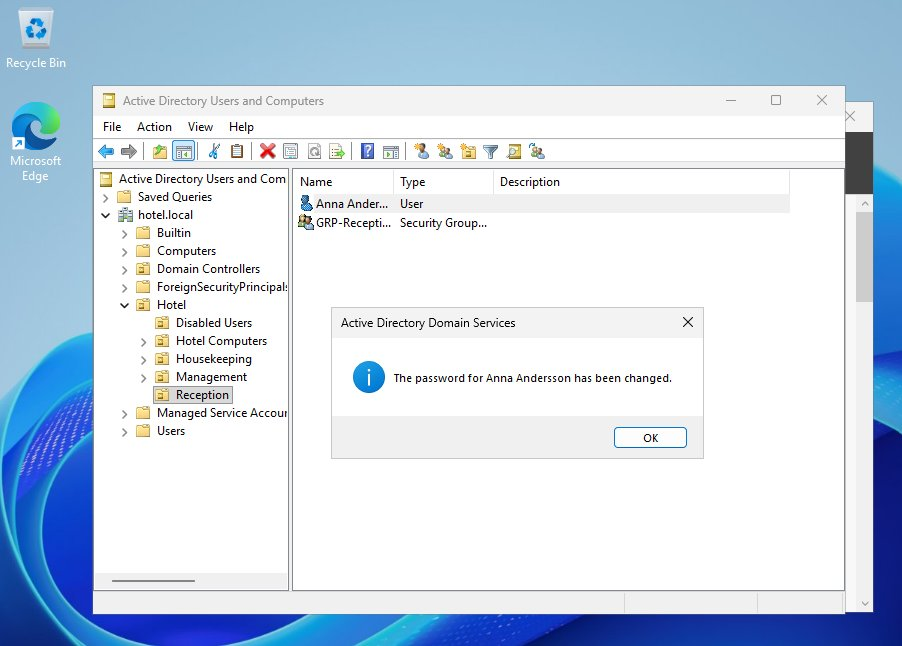
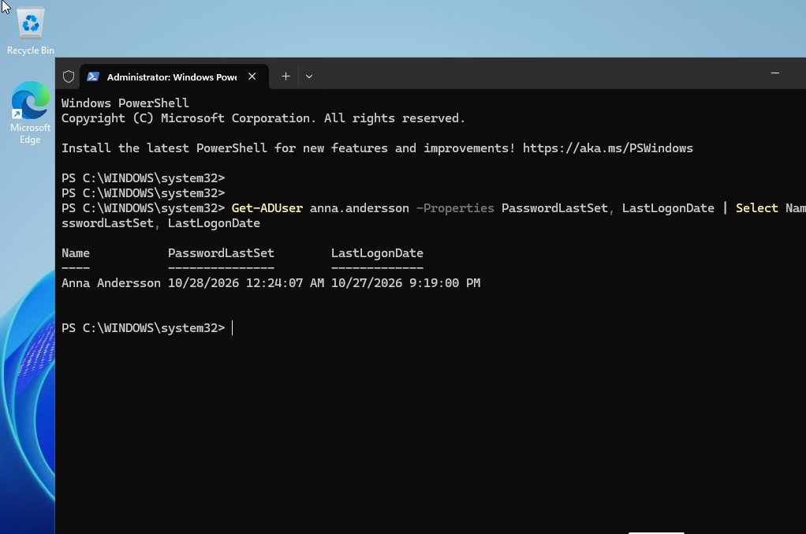

# Ticket 002: Forgotten password

| Field | Value |
|---|---|
| **Requester** | Anna Andersson, Reception |
| **Category** | Account / Password |
| **Problem** | Has forgotten her password |
| **Priority** | High (user cannot work) |
| **Time spent** | ~5 minutes |
| **Status** | Resolved |

## Actions

1. **Verified the caller's identity** before changing anything, by calling back on the number registered for the user. *(In the lab this step is a described procedure, since there was no real caller.)*
2. On HOTEL-DC01: **Active Directory Users and Computers → Hotel → Reception**, right-click **Anna Andersson → Reset Password**.
3. Set a temporary password that meets the policy (12+ characters).
4. Ticked **User must change password at next logon**, so IT never knows the user's real password.
5. Anna logged in on FRONTDESK-01 and chose her own new password.

## Verification

```powershell
Get-ADUser anna.andersson -Properties PasswordLastSet, LastLogonDate |
    Select Name, PasswordLastSet, LastLogonDate
```
`PasswordLastSet` shows the time of the reset.

| | |
|---|---|
|  |  |
| Password reset in Active Directory | `PasswordLastSet` updated |

*Note:* `LastLogonDate` is based on an attribute that only replicates about every 14 days, so it may not show the most recent logon.

## Result

The user regained access and set her own password.

## Notes

The reset itself is easy. The important part is checking **who** is asking, because attackers often call IT pretending to be an employee (social engineering).
