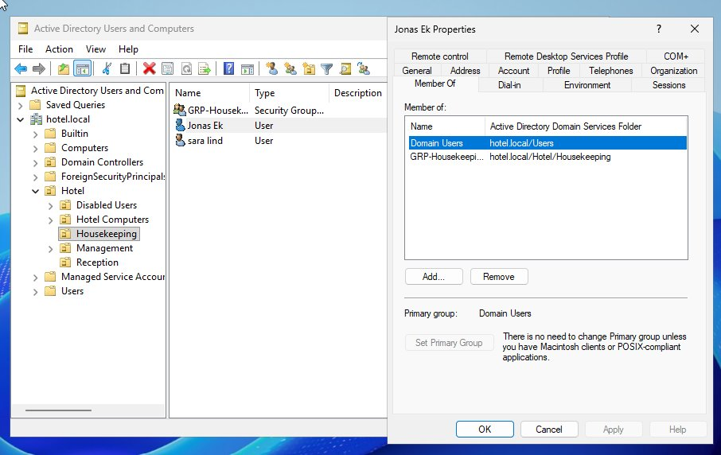
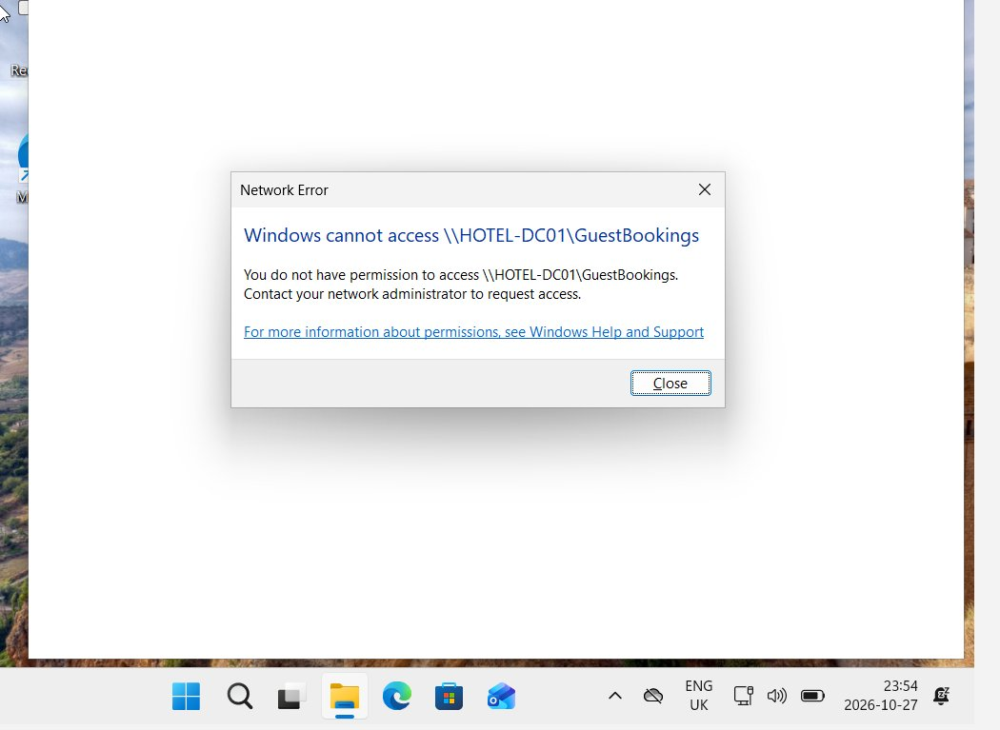

# Ticket 003: New employee (onboarding)

| Field | Value |
|---|---|
| **Requester** | Housekeeping manager |
| **Category** | Onboarding |
| **Problem** | Jonas Ek starts in Housekeeping and needs an account |
| **Priority** | Normal (planned) |
| **Time spent** | ~5 minutes |
| **Status** | Resolved |

## Actions

1. On HOTEL-DC01: **Active Directory Users and Computers → Hotel → Housekeeping**, right-click **Sara Lind** (same role) **→ Copy**.
2. First name `Jonas`, last name `Ek`, logon name `jonas.ek`.
3. Set a temporary password and ticked **User must change password at next logon**.
4. Checked the **Member Of** tab: `GRP-Housekeeping` was copied from the template account.

## Verification

- Jonas is a member of **Domain Users** and **GRP-Housekeeping** only.
- Logged in as `jonas.ek` on FRONTDESK-01 and tried `\\HOTEL-DC01\GuestBookings`. Access was **denied**, exactly like his colleague's.

| | |
|---|---|
|  |  |
| Correct group from the start | No access beyond his role |

## Result

The new employee got exactly the access his role needs, no more and no less.

## Notes

Copying an existing account in the same role is faster and less error-prone than building one from scratch, because group memberships come along automatically. The test confirms he didn't get more access than intended.
