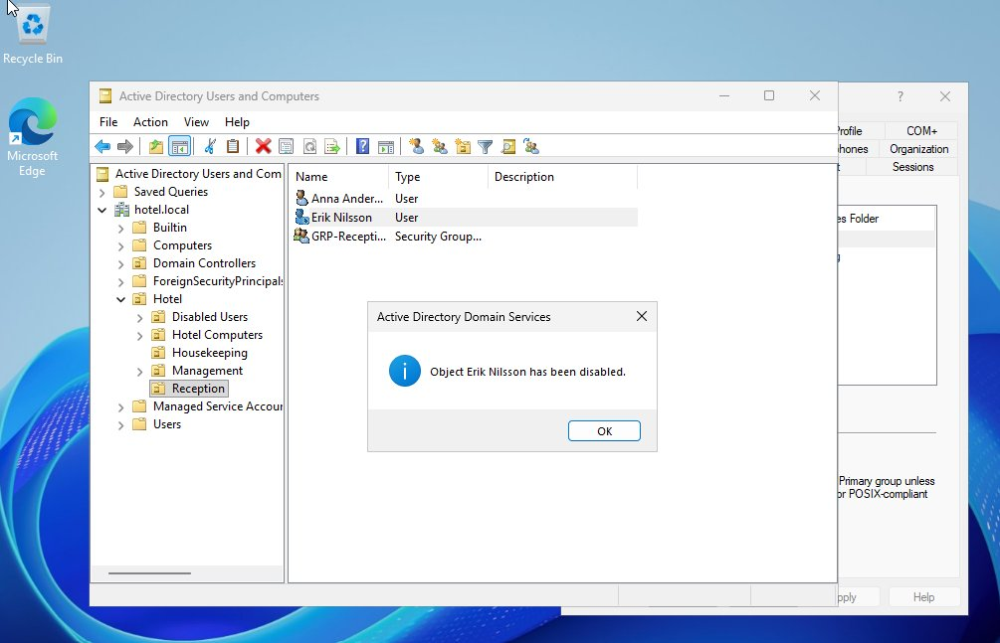
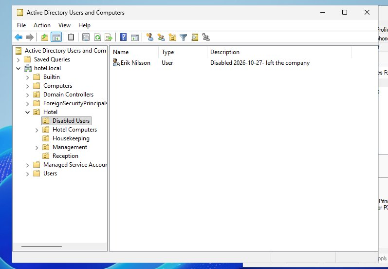
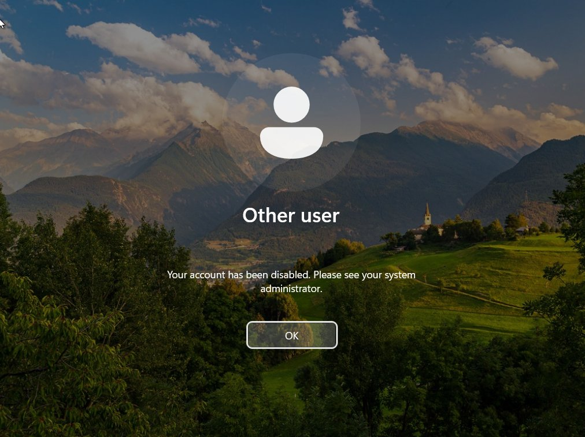

# Ticket 004: Employee leaving (offboarding)

| Field | Value |
|---|---|
| **Requester** | Reception manager |
| **Category** | Offboarding / Security |
| **Problem** | Erik Nilsson has left the company |
| **Priority** | High (security) |
| **Time spent** | ~10 minutes |
| **Status** | Resolved |

## Actions

1. On HOTEL-DC01: right-click **Erik Nilsson → Disable Account**.
2. **Member Of** tab: removed `GRP-Reception`, so no access remains even if the account were re-enabled by mistake.
3. **Description:** `Disabled 2026-10-27 – left the company`, so the next admin can see why and when.
4. Moved the account to the **Disabled Users** OU.
5. Tested logging in as Erik on FRONTDESK-01.

## Verification

On the client: *"Your account has been disabled. Please see your system administrator."*

On the domain controller:
```powershell
Get-ADUser erik.nilsson
```
Result: `Enabled : False`, `DistinguishedName : CN=Erik Nilsson,OU=Disabled Users,OU=Hotel,DC=hotel,DC=local`.

| | |
|---|---|
|  |  |
| Account disabled | In Disabled Users, with dated description |
|  |  |
| Logon blocked on the client | `Enabled False`, OU = Disabled Users (bottom half) |

## Result

The former employee can no longer log in and has no access to company data.

## Notes

- The account is **disabled, not deleted**, so files and history remain for audits and it can be restored if needed.
- Disabling only blocks **new** logons. An existing session stays open until sign-out, so in a real offboarding the user's sessions should also be ended.
- "Locked out" (ticket 001) and "disabled" are different: a lockout is automatic and temporary, while disabling is a deliberate admin action.
