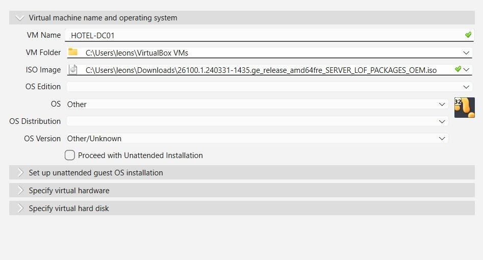
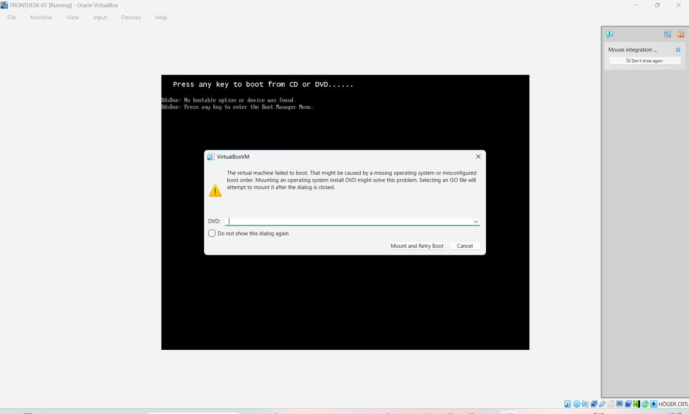
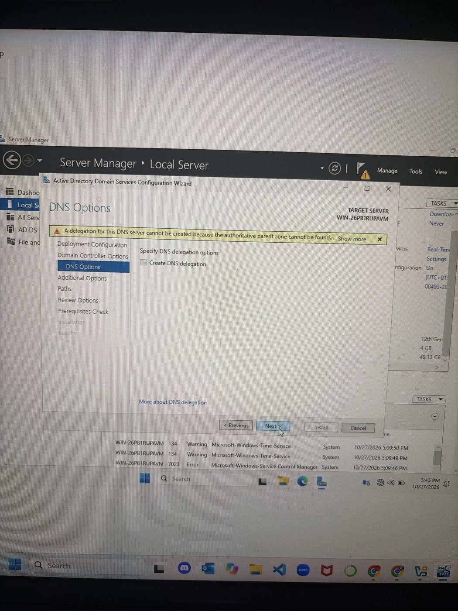
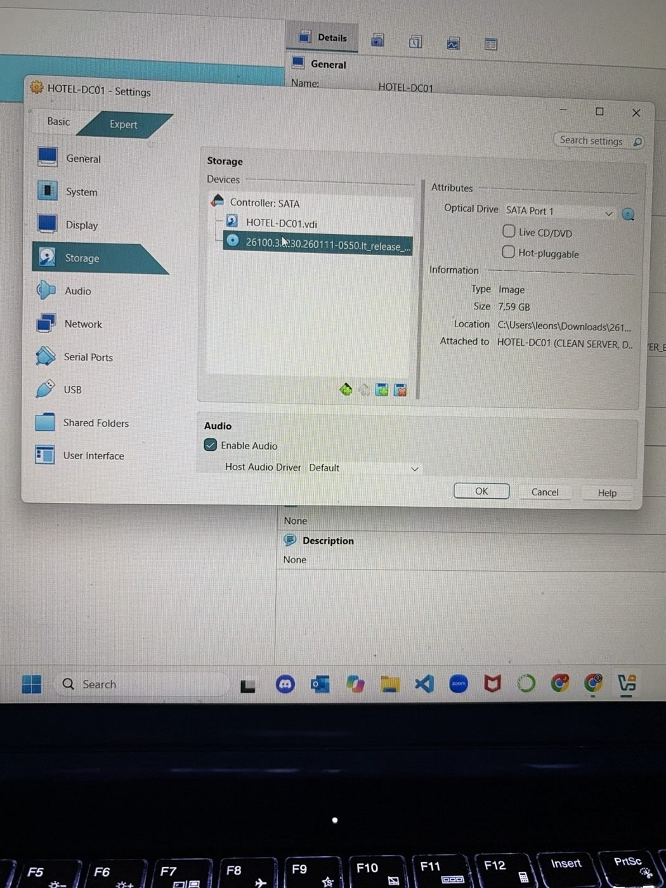
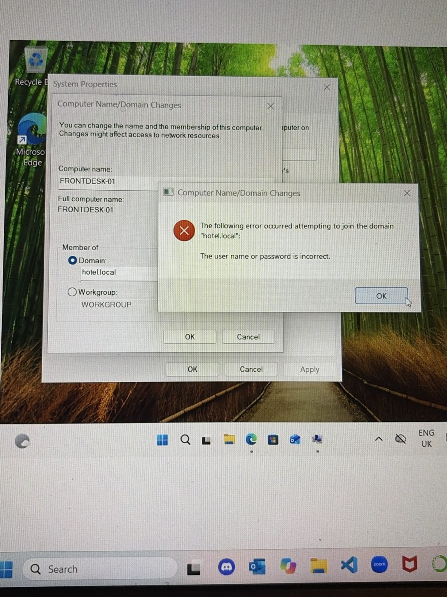

# Troubleshooting log

Every problem I hit while building the lab, in the order it happened. Most were about details in the environment, not about Windows itself.

| # | Problem | Cause | Fix |
|---|---|---|---|
| 1 | No Network menu in VirtualBox | VirtualBox was in Basic mode, which hides advanced menus | Switched to Expert mode |
| 2 | Server installation wouldn't start | Downloaded the languages/features ISO (`LOF_PACKAGES`), not the installer | Downloaded the `SERVER_EVAL` ISO |
| 3 | HotelNet missing from the adapter list | VirtualBox hadn't refreshed, and "NAT" was selected instead of "NAT Network" | Restarted VirtualBox, selected NAT Network → HotelNet |
| 4 | Long black screen on FRONTDESK-01 | Missed the "Press any key to boot from CD or DVD" prompt, so setup never started | Reset the VM and pressed a key immediately |
| 5 | "No bootable option or device was found" | The ISO had detached from the virtual optical drive | Re-mounted the Windows 11 ISO from the error dialog |
| 6 | Edition choice: Home or Pro | Windows 11 Home cannot join a domain | Installed Windows 11 Pro |
| 7 | HOTEL-DC01 never appeared in the VM list | The wizard never finished: "Proceed with Unattended Installation" re-ticked itself and greyed out Finish | Unticked it and created the VM again |
| 8 | VM settings greyed out | VirtualBox locks settings while a VM is running | Powered off the VM first |
| 9 | Host laptop only has 8 GB RAM | Two VMs at 4 GB each would leave nothing for the host | Ran one VM at a time and planned reduced memory for running both |
| 10 | Administrator password rejected | Windows Server password complexity requirements | Used 12+ characters with upper case, a number and a symbol |
| 11 | Ctrl+Alt+Del didn't reach the VM | The host captured the shortcut | Used Right Ctrl + Delete (VirtualBox Host key) |
| 12 | Wrong clock on the server | Default US time zone | Set the Stockholm time zone, since domain logons depend on correct time |
| 13 | Server still had its random name at promotion | The rename had never been saved | Cancelled, renamed to HOTEL-DC01, rebooted, then promoted |
| 14 | "Roles: 0" after promotion | Server Manager hadn't finished loading | Waited and refreshed, then AD DS and DNS appeared |
| 15 | Server booted into Windows Setup again | The install ISO was still attached | Removed the disk from the virtual drive |
| 16 | `nslookup hotel.local` timed out | The DNS service hadn't finished starting after a reboot | Checked `ipconfig` on both machines and retried once the server was up |
| 17 | Domain join: "user name or password is incorrect" | Password typed wrong on the client (UK keyboard layout) | Verified the password on the DC, then used `Administrator@hotel.local` with the password visible |
| 18 | A user couldn't log in, and another was in the wrong OU | `sara.lind` had never been created, and `erik.nilsson` sat in Housekeeping | Created Sara in Housekeeping with GRP-Housekeeping and moved Erik to Reception with GRP-Reception |

## Evidence

| | |
|---|---|
|  |  |
| #2: the `LOF_PACKAGES` ISO selected | #5: no bootable device |
|  |  |
| #13: target server still `WIN-…` | #15: install ISO still attached |
|  |  |
| #16: DNS request timed out | #17: credentials rejected, but domain found |

## Takeaways

- **Check the basics first.** Most problems were a setting, a missing step or a service that wasn't ready yet.
- **Read error messages literally.** "Password incorrect" during a domain join proved the network and DNS were working.
- **Verify before moving on.** Checking the server name *before* promotion avoided a much harder fix later.
